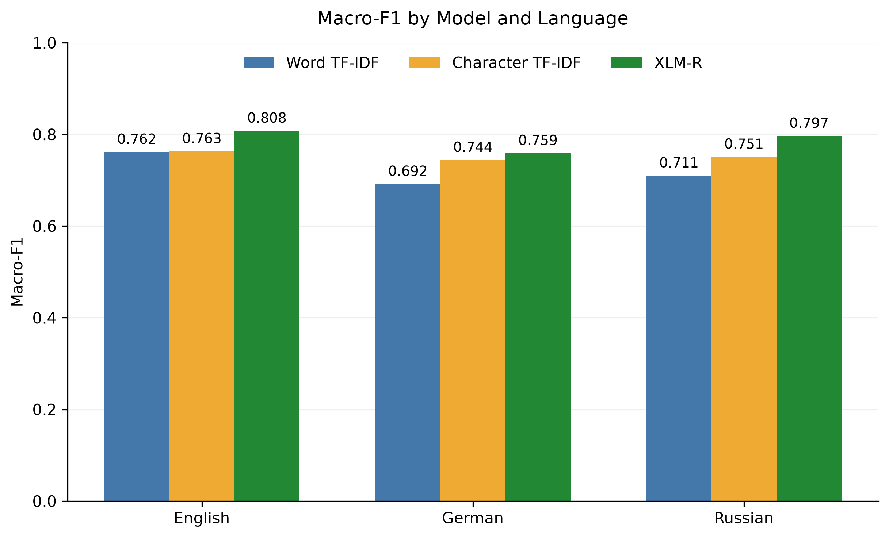
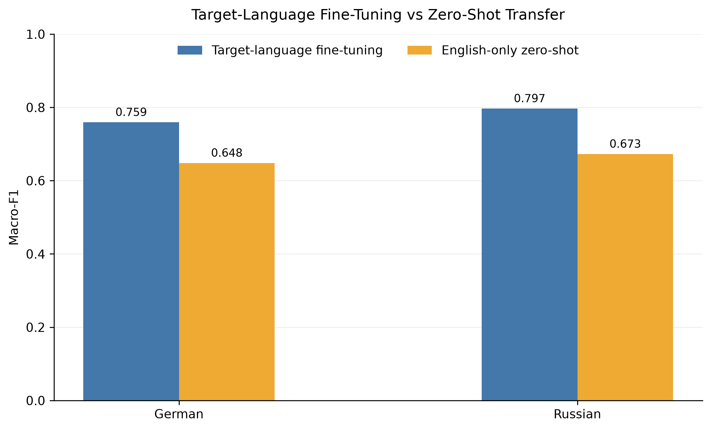
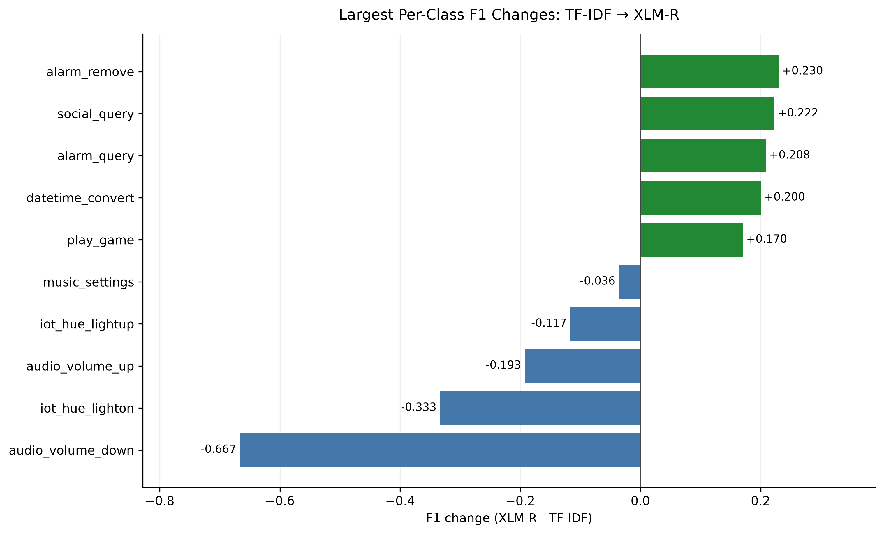
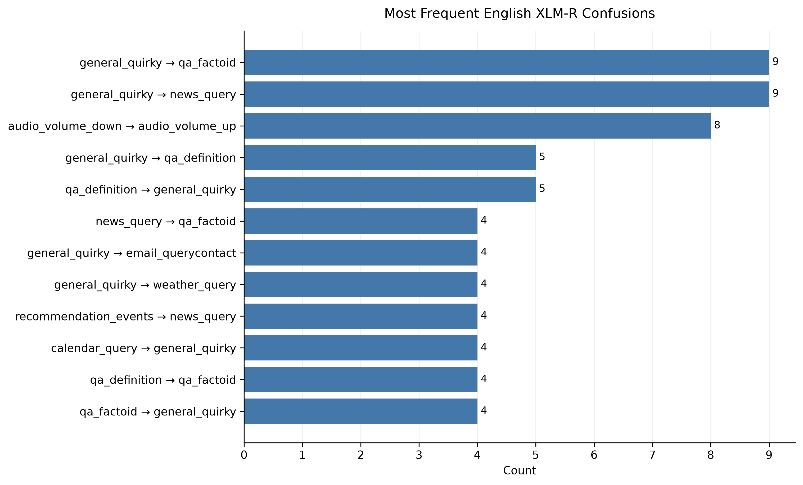

# Multilingual NLU Benchmark

This project explores multilingual intent classification on the Amazon MASSIVE dataset in English, German, and Russian.

I started with classical TF-IDF + Logistic Regression baselines, comparing word-level and character-level representations across the three languages. I then fine-tuned XLM-R separately for each language and evaluated zero-shot cross-lingual transfer by training on English only and testing on German and Russian.

The final part of the project focuses on error analysis: which intent distinctions improve with XLM-R, which confusions remain, and how the error patterns change under cross-lingual transfer.

## Dataset

The experiments use the `AmazonScience/massive` dataset through the Hugging Face `datasets` library.

The task is utterance-level intent classification:

- Input: `utt`
- Target: `intent`
- Number of intent classes: 60

| Language | Locale | Train | Validation |
|---|---|---:|---:|
| English | `en-US` | 11,514 | 2,033 |
| German | `de-DE` | 11,514 | 2,033 |
| Russian | `ru-RU` | 11,514 | 2,033 |

The original MASSIVE intent IDs are retained throughout the experiments.

All results reported in this repository are based on the validation splits.

## Experiments

### TF-IDF baselines

The classical baseline uses Logistic Regression with two text representations:

- Word TF-IDF
- Character TF-IDF with `char_wb` n-grams from 3 to 5 characters

The same classifier is used for both representations:

`LogisticRegression(max_iter=1000)`

The comparison is run independently for English, German, and Russian.

### XLM-R fine-tuning

The Transformer experiments use `FacebookAI/xlm-roberta-base`.

A separate XLM-R model is fine-tuned on the training split of each language. The model is trained with a manual PyTorch training loop using Hugging Face Transformers.

The main training settings are:

| Setting | Value |
|---|---|
| Epochs | 5 |
| Learning rate | `2e-5` |
| Optimizer | AdamW |
| Weight decay | `0.01` |
| Warmup | 10% |
| Train batch size | 8 |
| Evaluation batch size | 8 |
| Gradient accumulation | 2 |
| Effective batch size | 16 |
| Maximum sequence length | 64 |
| Random seed | 42 |
| Mixed precision | BF16 when supported, otherwise FP16 |

Dynamic batch padding is used.

### Cross-lingual transfer

For the cross-lingual experiment, XLM-R is fine-tuned only on the English training split. The same final model is then evaluated on the English, German, and Russian validation sets.

German and Russian therefore receive no task-specific fine-tuning in this setting.

Here, zero-shot refers to zero-shot transfer for the downstream intent-classification task. XLM-R itself already has multilingual pretraining.

## Results

The overall validation results are:

| Language | Model | Accuracy | Macro-F1 |
|---|---|---:|---:|
| English | Word TF-IDF | 0.8057 | 0.7619 |
| English | Character TF-IDF | 0.8175 | 0.7634 |
| English | XLM-R | 0.8824 | 0.8083 |
| German | Word TF-IDF | 0.7688 | 0.6920 |
| German | Character TF-IDF | 0.7964 | 0.7444 |
| German | XLM-R | 0.8524 | 0.7594 |
| Russian | Word TF-IDF | 0.7614 | 0.7105 |
| Russian | Character TF-IDF | 0.7954 | 0.7514 |
| Russian | XLM-R | 0.8652 | 0.7970 |



Character TF-IDF provides only a small gain over word TF-IDF in English, but the improvement is larger in German and Russian.

XLM-R achieves the best overall validation performance in all three languages.

### Cross-lingual transfer

The English-only XLM-R model is also evaluated directly on German and Russian.

| Evaluation language | Target-language XLM-R Macro-F1 | English-only XLM-R Macro-F1 |
|---|---:|---:|
| German | 0.7594 | 0.6482 |
| Russian | 0.7970 | 0.6728 |



Compared with target-language fine-tuning, English-only transfer reduces Macro-F1 by 0.1112 in German and 0.1242 in Russian.

The aligned prediction comparison gives a similar picture at the example level. In German, 260 validation examples are classified correctly by the German-fine-tuned model but incorrectly by the English-trained model. In Russian, the corresponding number is 226.

The reverse also happens in a smaller number of cases: 61 German examples and 42 Russian examples are correct under English-only transfer but wrong under target-language fine-tuning.

These results show that XLM-R supports useful zero-shot transfer, but task-specific target-language fine-tuning still provides a substantial advantage in this setup.

## Error analysis

### Word TF-IDF vs. XLM-R

For the English validation set, the two models behave as follows:

| Outcome | Examples |
|---|---:|
| Both correct | 1,579 |
| Word TF-IDF wrong, XLM-R correct | 215 |
| Word TF-IDF correct, XLM-R wrong | 59 |
| Both wrong | 180 |

Word TF-IDF makes 395 errors in total, while XLM-R makes 239. XLM-R corrects 215 of the baseline errors, but also introduces 59 new errors on examples that TF-IDF classified correctly.

Many of the corrected cases involve intents that share similar vocabulary but differ in the user's requested action. Typical examples include:

- `email_query` vs. `email_sendemail`
- `alarm_query` vs. `alarm_set`
- `calendar_query` vs. `calendar_set`

For example, the utterance:

`do i have an alarm set`

contains the word `set`, but the actual intent is `alarm_query`. The word-level TF-IDF model predicts `alarm_set`, while XLM-R predicts the correct intent.

The same pattern appears in the per-class results:

| Intent | TF-IDF F1 | XLM-R F1 |
|---|---:|---:|
| `alarm_query` | 0.6250 | 0.8333 |
| `calendar_query` | 0.7415 | 0.8945 |
| `transport_query` | 0.7714 | 0.9167 |

This suggests that contextual representations help with some intent boundaries that are difficult to separate using lexical overlap alone.

The improvement is not uniform across all classes. For example, `audio_volume_down` drops from F1 0.6667 to 0.0000 in the saved English run. All eight validation examples from this class are predicted as `audio_volume_up` by XLM-R.



### Remaining confusions

The most frequent English XLM-R errors are concentrated in a small number of intent pairs:



Common confusions include:

- `general_quirky` vs. `qa_factoid`
- `general_quirky` vs. `news_query`
- `qa_definition` vs. `general_quirky`
- `news_query` vs. `qa_factoid`
- `audio_volume_down` vs. `audio_volume_up`

Some of these errors reflect fine-grained model mistakes. Others are also related to ambiguous boundaries in the intent inventory.

For example:

`who is leading the formula one race right now`

is labeled `news_query`, but it is also naturally similar to a factual question, which helps explain the confusion with `qa_factoid`.

Another example is:

`the weather is sunny today`

which is labeled `general_quirky` rather than `weather_query`, because it mentions weather without actually requesting weather information.

These cases show that some remaining errors are not simply caused by missing vocabulary. They also involve subtle distinctions between similar intent definitions.

### Cross-lingual errors

The German and Russian transfer analyses compare the English-trained model with the corresponding target-language fine-tuned model on the same validation examples.

In Russian, several transfer errors show a consistent pattern:

- `alarm_set` vs. `calendar_set`
- `alarm_query` vs. `calendar_query`
- `alarm_remove` vs. `calendar_remove`

In these cases, the English-trained model often preserves the general operation, such as setting, querying, or removing something, but predicts the wrong domain.

Other recurring Russian transfer confusions include:

- `iot_hue_lightdim` vs. `iot_hue_lightup`
- `takeaway_query` vs. `takeaway_order`
- `play_podcasts` vs. `play_audiobook`

German shows a more mixed set of transfer errors, including:

- `play_music` vs. `play_game`
- `general_joke` vs. `general_quirky`
- `alarm_set` vs. `iot_wemo_on`
- `calendar_query` vs. `general_quirky`

These observations show that cross-lingual transfer changes the error structure as well as the aggregate score. The current experiments do not isolate whether the remaining transfer gap is mainly due to morphology, subword tokenization, representation alignment, or other language-specific factors.

## Reproducing the experiments

The project uses `uv` for environment and dependency management. Run the commands from the repository root.

Install the locked environment:

```bash
uv sync --locked
```

Run the multilingual TF-IDF comparison:

```bash
uv run python src/compare_tfidf_multilingual.py
```

Run target-language XLM-R fine-tuning:

```bash
uv run python src/xlmr_benchmark.py
```

Run English-only cross-lingual transfer:

```bash
uv run python src/xlmr_cross_lingual.py
```

Run the English TF-IDF vs. XLM-R error analysis:

```bash
uv run python src/error_analysis_xlmr.py
```

Run the German and Russian cross-lingual error analysis:

```bash
uv run python src/error_analysis_cross_lingual.py
```

Regenerate the figures from the saved CSV results:

```bash
uv run python src/visualize_results.py
```

The XLM-R experiments require a CUDA-capable GPU. Dataset and pretrained-model downloads require an internet connection.

The visualization script does not retrain the models. It reads the saved result files in `results/` and writes the plots to `figures/`.

## Repository structure

```text
multilingual-nlu-benchmark/
├── src/
│   ├── inspect_data.py
│   ├── train_baseline.py
│   ├── compare_tfidf_en.py
│   ├── compare_tfidf_multilingual.py
│   ├── error_analysis_en.py
│   ├── error_analysis_xlmr.py
│   ├── error_analysis_cross_lingual.py
│   ├── xlmr_benchmark.py
│   ├── xlmr_cross_lingual.py
│   └── visualize_results.py
├── results/
├── figures/
├── pyproject.toml
├── uv.lock
└── README.md
```

The experiment scripts under `src/` cover the progression from classical baselines to XLM-R and cross-lingual evaluation.

The `results/` directory contains aggregate metrics, saved predictions, and per-class analysis results. The `figures/` directory contains the plots used in this README.

## Limitations

The experiments cover three languages, one dataset, and one random seed. The observed differences therefore should not be treated as general conclusions about multilingual intent classification.

All reported scores use the validation splits. The target-language XLM-R experiments also use validation Macro-F1 to identify the best epoch, so an untouched test set would be needed for a final estimate of generalization performance.

Some intent classes have very small validation support. Large per-class F1 changes for these classes can therefore be caused by only a few examples and should be interpreted cautiously.

The cross-lingual experiments show a clear performance gap between target-language fine-tuning and English-only transfer, but they do not isolate the cause of that gap. Morphology, subword tokenization, cross-lingual representation alignment, and language-specific variation are possible factors that would require separate controlled analysis.

Sequence truncation is unlikely to explain the current results. During the recorded training diagnostics, no English, German, or Russian training utterance exceeded the configured maximum sequence length of 64 tokens.

Possible extensions include multilingual joint fine-tuning, limited target-language supervision, evaluation across additional languages and random seeds, and a more focused analysis of subword fragmentation and cross-lingual representations.